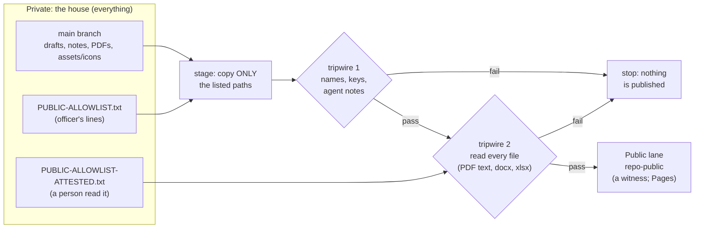
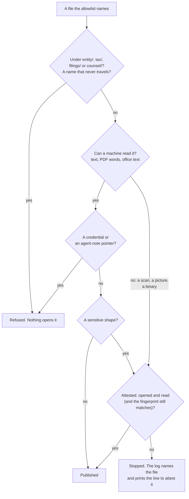
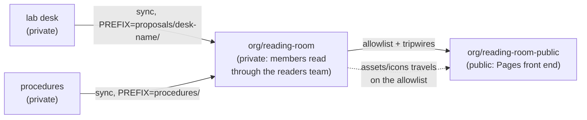

# SOP-OPS-003 · Private houses everything, public lanes witness


**Department:** OPS · **ID:** 003 · **Status:** draft (approved when tagged) · **Owner:** repository steward; officers decide each allowlist line · **Last changed:** 2026-11-01

##  Purpose
Everything the organisation writes lives first in a **private** repository: the house. A **public lane** (a repository whose name ends `-public`) is a witness: it carries only the pages an officer listed, copied by a machine after a tripwire, and nobody edits it by hand. This procedure says how a page reaches a public lane, how the reading room is built from the same mechanism, and why its icons never go stale.

##  Scope
Every private repository with a public lane: procedures (`ops-standard-operating-procedures` → `-public`), the reading room (`reading-room` → `reading-room-public`), legal (`legal` → `legal-public`, narrow), monitoring outputs, and any lab desk that feeds a room. Site repositories with rehearsal and live lanes follow the same rule through their own build (SOP-OPS-001).

##  Roles
| Role | Does |
|---|---|
|  Officer | decides each allowlist line, by pull request; attests a file a machine could not read |
|  Steward | provisions the deploy key, keeps the workflow, reads the sync's log |
|  Helper | proposes allowlist lines in a pull request; never edits a public lane; never attests |
|  The sync workflow | stages, runs the tripwires, commits to the lane |

##  The mechanism



###  The rule, in one sentence
> **A public lane never publishes a file a machine or a person has not read.**

**Allowlist, not exclude list.** A new file is private until a line names it, so forgetting to list something leaves it private: the safe failure. How the tripwire reads each kind of file, and what nothing opens, is the section [after the files](#-the-tripwire-a-public-lane-never-publishes-a-file-a-machine-or-a-person-has-not-read).

##  The files, in a repository that has a public lane

| File | What it does |
|---|---|
| `PUBLIC-ALLOWLIST.txt` | one path per line (a file, or a folder copied whole); no globs, no `..`, no hidden paths. Empty means nothing is public |
| `PUBLIC-ALLOWLIST-ATTESTED.txt` | files a person opened and read, one per line, never a folder |
| `scripts/sync-allowlist.sh` | `stage` copies only the listed paths and runs tripwire 1; `apply` writes them into the lane's clone. Runs locally as a dry run |
| `scripts/scan-public-lane.sh` | tripwire 2: reads every staged file, refuses what it cannot read unless attested |
| `.github/workflows/sync-public.yml` | runs both on each push to `main` (and after the PDF render), commits to the lane through a **deploy key** held as a secret; inert, and green, until that secret exists |

A dry run on your own machine, before an officer says yes to a line (`brew install poppler` once, for `pdftotext`):
```sh
TRIPWIRE_PUBLIC=1 sh scripts/sync-allowlist.sh stage PUBLIC-ALLOWLIST.txt /tmp/public-stage
```
*You should see:* the staged paths listed and no `tripwire:` line; `ls /tmp/public-stage` shows exactly the allowlist.

##  The tripwire: a public lane never publishes a file a machine or a person has not read

Every public lane (a `-public` twin, a public reading room, a public monitor) is filled by a sync that copies only
the allowlisted paths. Before anything is pushed, a tripwire reads **every** staged file. The rule is one sentence:

> **A public lane never publishes a file a machine or a person has not read.**

Before 2026-11-01 the check read only plain text, so a PDF, a picture or a Word file passed through unread. Now each
kind of file is read its own way, or stopped.

###  How each file is read

| | Kind of file | How the tripwire reads it | Stopped when |
|---|---|---|---|
|  | Text (Markdown, HTML, SVG, scripts) | read directly | it carries a credential, a pointer into agent notes, or a sensitive shape (below) |
|  | PDF | its words are pulled out with `pdftotext` and read the same way | the same, **or** it has no words at all, or some pages have none (a scan, an image-only page), or it will not open |
|  | `.docx`, `.xlsx`, `.pptx`, OpenDocument | unzipped; the text inside is read | the same, **or** it carries an embedded picture or object |
|  | Pictures and fonts | checked to be what their name says | they sit anywhere other than an `assets/` or `icons/` folder |
|  | Anything else (archives, old `.doc`, unknown binaries) | cannot be read here | always, unless a person attests it |

**Sensitive shapes** are the ones a public page should almost never carry: an employer or social-security number
shape, a label for a tax identifier or a birth date, a street address or post-office box, the word for a giver of
gifts, an account number longer than four digits beside its label, and the fleet's personal-matter words. The exact
patterns live in the script, assembled from pieces so the script itself can travel; this page names them in plain
words so it can travel too.

###  When a person reads it instead: attestation

A machine cannot read a scanned letter or a photograph. A person can. When the tripwire stops a file it prints the
exact line to add, and an officer who has **opened the file and read every page** adds it to
`PUBLIC-ALLOWLIST-ATTESTED.txt` by pull request:

```text
pdf/OPS/SOP-OPS-001-how-a-change-travels.pdf | <officer> | 2026-11-01 | opened and read | sha256:<fingerprint>
```

The fingerprint is optional and recommended: with it, the attestation ends the moment the file changes, and the next
sync asks for a fresh reading. An attestation clears a sensitive shape, a picture outside `assets/`, and a PDF with
no words. It never clears the three things below.

###  What nothing opens

1.  **A credential or a pointer into agent notes** found in any readable text, attested or not. Remove it from the file.
2.  **The legal lanes by path:** `entity/`, `tax/`, `filings/`, `counsel/`. A file under any of them is refused whatever the allowlist or an attestation says. The legal public lane carries only its README, its folder map and policy skeletons.
3.  **Names that never travel:** agent-note folders, tool configuration (`CLAUDE.md`, `AGENTS.md`, `.claude/`, `.github/`), keys, wallets, environment files, symbolic links, and any file over 15 MB.



###  Running it yourself

```sh
brew install poppler                                   # once, on a Mac: gives pdftotext
sh scripts/scan-public-lane.selftest.sh                # proves it: a planted fake number in a PDF must be refused
TRIPWIRE_PUBLIC=1 sh scripts/sync-allowlist.sh stage PUBLIC-ALLOWLIST.txt /tmp/stage   # a dry run of the sync
sh scripts/scan-public-lane.sh /tmp/stage PUBLIC-ALLOWLIST-ATTESTED.txt                 # or scan any folder
```

*You should see:* `every file read; clean`, or a list of refused files, each with its reason. The scanner never
prints what it matched, only the kind of match and where, so a found secret does not land in a log. On GitHub the
sync installs `pdftotext` (`poppler-utils`) and runs the self-test before every sync; without a PDF reader, no PDF
travels.

**Master copy:** `my-template/scripts/scan-public-lane.sh` and its self-test. Every repository's copy is the
master, byte for byte; the self-test in my-template checks the SOP template's copies.

##  The reading room, built the same way



-  **The private room** gathers what members may read. Each source writes only into its own folder (`PREFIX`), so two sources never overwrite each other. Its README is the index; PDFs sit beside the markdown. Members read it through the **readers** team (SOP-IT-002, SOP-GOV-002).
-  **The public room** receives only the allowlisted pages of the private room. Its own top-level files (its README, its Pages front end) are **reserved**: the sync never overwrites them. With `MANIFEST` set, each sync writes the list of what it carried, so the front end shows exactly what arrived.
-  **The public room links to the private one.** A visitor who clicks it sees a 404; a member sees the room. Names may be public; contents stay private (`my-template/NAMES-POLICY.md`).
-  **Decks:** welcome decks live in the organisation's public `.github/decks/`; members-only decks live in the private room. The rooms link to the decks rather than copying them.

###  Icons that never go stale
Every page draws its icons from the repository's own `assets/icons/` with a relative path (`../assets/icons/route.svg`). Put **`assets/icons`** on the allowlist as one line, and every sync carries the whole folder from the house to the lane. A recoloured or added icon in the house reaches the lane on the next sync; nobody copies icons by hand, so the lane's icons cannot drift. (Pictures under `assets/` or `icons/` are the one kind of image tripwire 2 accepts without an attestation.)

##  PIR®'s public lanes, and where the tripwire stands (read 2026-11-01)

Every sync in `psychedelicsinrecovery` that writes to a public repository, found by listing each repository's
workflows (not from memory), and what the PDF-reading tripwire found when it was run over what each lane publishes.
**Enforced** means a refusal stops the sync. **Report** means the tripwire runs on every sync and names each file it
would refuse as a warning, without stopping a lane that is already live; each report lane becomes enforced
(`TRIPWIRE_ENFORCE: "1"` in its workflow) once an officer has dealt with the files named.

| | Source → public lane | How it copies | Live? | Tripwire | What it found |
|---|---|---|---|---|---|
|  | `ops-standard-operating-procedures` → `-public` | allowlist, deploy key | inert until `SOP_PUBLIC_DEPLOY_KEY` | **enforced** | clean: the universal procedures, their PDFs, `assets/icons` |
|  | `reading-room` → `reading-room-public` | allowlist, deploy key; `public-site/` becomes the room's front page | inert until `READING_ROOM_PUBLIC_DEPLOY_KEY` | **enforced** | clean: 000 *Start here* and the procedure PDFs |
|  | `board-of-directors` → `-public` | filter-repo (history travels) | live | **enforced** | clean, at the head and in every version in history |
|  | `public-relations` → `-public` | filter-repo | live | **enforced** | clean, head and history |
|  | `catalyst-desk` → `-public` | `site/` copied | live | **enforced** | clean |
|  | `alex-desk` → `-public` | the built `site/dist` | live | **enforced** | clean (the published copy) |
|  | `pr-desk`, `github-desk`, `techcom-desk`, `litcom-desk` → `-public` | `portal/` copied | live | report | one picture each, `social-card.jpg`, at the portal's root (outside `assets/`): an officer opens it and attests it |
|  | `literature-committee` → `-public` | filter-repo | live | report | four Keynote decks (`publications/2026/*.key`) travel unread: no machine reads a Keynote file, and the `.key` name never travels. An officer exports each as a PDF and lists the PDFs instead |
|  | `tech-committee` → `-public` | filter-repo | live | report | a few files for an officer to review (the list is kept with the steward, not here); two street-address shapes in the public website's crawl (meeting and convention venues) for an officer to attest |
|  | `changelog-astro` → `-public` | the built Astro site, over a filtered history | live | report | 128 generated share pictures under `og/` (outside `assets/`); street-address shapes in five pages and feeds (meeting places on the map, `rss.xml`, `search.json`, `latest.json`) for an officer to attest; anything else for review is listed with the steward, not here |
|  | `.github-private` → `.github` (`CONTACTS.md` only) | `scripts/publish-public-contacts.py` writes a masked copy (personal emails as `***`, members-only sections left out) | live | **none yet** | not run: this lane was missed in the first listing and added on review (2026-11-01). It carries one markdown file, so the tripwire's text checks apply; the next step is the same tripwire step in `publish-public-contacts.yml` |
|  | the lab desk `drasticstatic/pir` → `reading-room/from-the-lab/` | allowlist, deploy key | inert | not a public lane | private to private: the room's members read it, visitors never do |

Each source carries its own copy of `scripts/scan-public-lane.sh` and its self-test, byte for byte the master in
`my-template/scripts/`, and each sync runs the self-test before it scans.

##  Steps: publishing a page
1. Open a pull request that adds the page's path (and its PDF's path, and `assets/icons` if not already there) to `PUBLIC-ALLOWLIST.txt`. *You should see:* a one-line diff per path.
2. Run the dry run above, and paste its result into the pull request. *You should see:* no `tripwire:` line.
3. If the dry run refuses a file a machine cannot read, an officer opens it, reads every page, and adds an attestation line in the same pull request.
4. An officer merges (merge commit). *You should see:* the sync workflow run on `main`, green.
5. Open the lane. *You should see:* the page and its icons; nothing else new.

**To withdraw a page:** remove its line by pull request. The next sync removes it from the lane. (Git history in the lane keeps the old commit; if the page should never have been public, tell the steward, who decides whether the lane's history needs more.)

##  Verification
The lane's tree contains exactly the allowlisted paths plus its reserved files; the last sync run is green; `PUBLIC-ALLOWLIST-ATTESTED.txt` names an officer and a date for every non-text file in the lane outside `assets/` and `icons/`.

##  Troubleshooting
| Symptom | Likely cause | What to do |
|---|---|---|
| The sync run is green but nothing changed | the deploy key secret is not provisioned yet (inert by design), or the allowlist is empty | the steward provisions the key; an officer adds a line |
| `tripwire:` refuses a PDF | it has no extractable text (a scan) or a sensitive shape | read it; attest it, or replace it with a text PDF; never attest a personal matter |
| The lane's icons are missing | `assets/icons` is not on the allowlist | add the line |
| Someone edited the lane by hand | the next sync overwrites what it owns | make the change in the house instead |
| The sync fails pushing to the lane | the strict ruleset on a lane | lanes take the deletion-only ruleset (`my-template/branch-protection/`) |

##  Related
- SOP-OPS-001 *How a change travels* · SOP-OPS-002 *Pull requests and Promotes* · SOP-IT-002 *Reading room and helper access* · SOP-GOV-002 *GitHub collaboration*
- `my-template/NAMES-POLICY.md` (names may be public, contents stay private), `my-template/LUCID.md` (icons and diagrams)
- `my-template/workflow-templates/sync-public-allowlist.yml` (the same pattern for any repository)

##  Change log
| Date | Change | By |
|---|---|---|
| 2026-11-01 | Drafted: the rule (a public lane never publishes a file a machine or a person has not read), the allowlist files, the reading room's mechanics, icons carried by the sync; the tripwire section included whole from `OPS/_fragments/tripwire.md` (the tripwire package's own text) | Alfred |
| 2026-11-01 | PIR®'s copy: PIR®'s thirteen public lanes and the tripwire's reading of each (six enforced, seven in report mode, with what an officer needs to do), found by listing every repository's workflows | Alfred |
| 2026-11-01 | Review: a fourteenth lane added, `.github-private` → `.github` (the masked `CONTACTS.md`), which the first listing missed; it has no tripwire yet | Alfred |
| 2026-11-01 | Review: the `tech-committee` and `changelog-astro` rows name only what an officer attests; the fuller review list is kept with the steward | Alfred |
